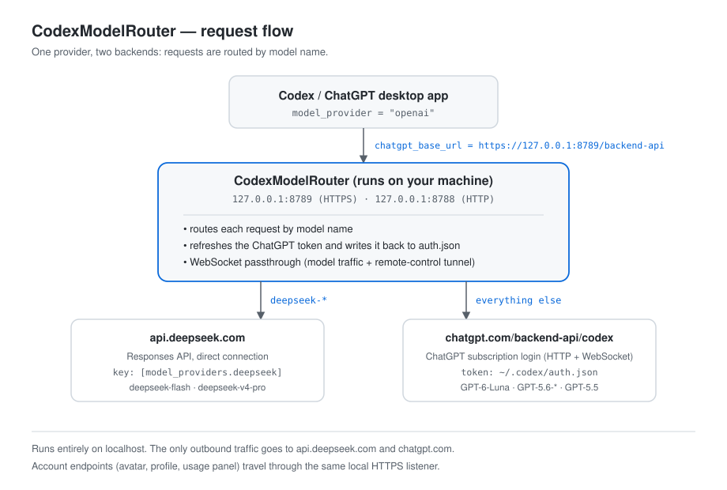

# 交接文档 · Handover

> 维护者：Barry Wang · 最后更新：2026-11-02 · 对应版本：`7ceebf9`
>
> ⚠️ 本文档会随公开仓库发布，因此**不包含**账号邮箱、workspace/account id 等个人信息。
> 需要查看当前账号信息时运行：`powershell -ExecutionPolicy Bypass -File switch-mode.ps1 -Mode status`

## 0. TL;DR（三十秒看懂）

- **它是什么**：一个本地 HTTPS 路由器，让 Codex 桌面版在**同一个模型下拉框**里同时使用
  DeepSeek 和 ChatGPT 登录模型，同时保住头像/资料/用量面板。
- **日常怎么用**：双击桌面「CodexModelRouter 启动器」；不想切换任何东西时，直接打开 ChatGPT 即可。
- **它在哪**：`D:\Project\CodexModelRouter`（公开仓库：`https://github.com/wyj877058568/CodexModelRouter`）。
- **出问题先看**：`router.log`（每次请求一行 JSON）和 `%USERPROFILE%\.codex\logs_2.sqlite`（app-server 日志）。
- **三条铁律**：不要杀 `CodexModelRouter.exe`；改 `.ps1` 必须存成 UTF-8 **带 BOM**；改完代码要重新打包并同步 GitHub。

## 1. 这个项目是什么

Codex 桌面版的模型选择器只切换"模型名"，provider 是全局设置；而 ChatGPT 登录模式使用
`chatgpt.com/backend-api/codex` 这套专有协议（Responses + WebSocket），通用网关（LiteLLM、one-api）
无法代理。

本项目在本地起一个 HTTPS 服务，把 Codex 的 `chatgpt_base_url` 指向它，再按模型名分流：

| 模型 | 去向 | 凭据 |
| --- | --- | --- |
| `deepseek-*` | `api.deepseek.com` | `config.toml` 里 `[model_providers.deepseek]` 的 key |
| 其它（GPT） | `chatgpt.com/backend-api/codex` | `~/.codex/auth.json` 的 ChatGPT 登录令牌 |

因为 provider 仍是内置的 `openai`，客户端的账号、头像、资料、用量面板都照常工作。

## 2. 当前运行环境（事实快照 2026-11-02）

| 项目 | 值 |
| --- | --- |
| 安装目录 | `D:\Project\CodexModelRouter` |
| 可执行文件 | `D:\Project\CodexModelRouter\CodexModelRouter.exe`（PyInstaller onefile，约 8 MB） |
| 监听端口 | `127.0.0.1:8789`（HTTPS，给 `chatgpt_base_url`）、`127.0.0.1:8788`（HTTP，兼容旧会话） |
| 计划任务 | `CodexModelRouter`，登录时启动 + 每 5 分钟自检，动作指向上面的 exe |
| 配置 | `%USERPROFILE%\.codex\config.toml`（`model_provider = "openai"`、`chatgpt_base_url` 指向 8789） |
| 证书 | 本地自签 CA（`tls\ca.crt`），已装入「当前用户 → 受信任的根证书颁发机构」，有效期至 2036-09 |
| 账号 | 由 `switch-mode.ps1 -Mode status` 显示（当前为免费账号 + 个人工作空间） |
| 仓库 | `main` 分支，与 `origin/main` 同步 |

**安全说明**：路由器只绑定 `127.0.0.1`，流量不经过 Windows 防火墙，因此不需要任何放行规则。
`tls/`（含私钥）、`router.log`、打包出的 exe 都在 `.gitignore` 里，不会被推送到 GitHub。

## 3. 架构



```
Codex / ChatGPT 桌面客户端
        │  chatgpt_base_url = https://127.0.0.1:8789/backend-api
        ▼
CodexModelRouter.exe
   ├─ deepseek-*       → api.deepseek.com                （HTTP，直连）
   └─ 其它模型/账号接口 → chatgpt.com/backend-api/codex    （HTTP + WebSocket 透传）
```

实现要点（都在 `router.py`，纯标准库）：

- **按模型名分流**：`deepseek-*` 走 DeepSeek，其余走 ChatGPT。
- **令牌自动刷新**：上游返回 401 时用 `refresh_token` 换新令牌并写回 `auth.json`。
- **账号跟随**：每次请求重新读取 `auth.json`，所以切换账号不需要改代码、不需要重启路由器。
- **WebSocket 透传**：模型请求与远程控制隧道都是 WS；服务端驱动的隧道用 select 双向转发。
- **WS→SSE 桥接**：DeepSeek 侧把客户端的 WS 消息转成 HTTP SSE，再把事件回放成 WS 文本帧。
- **浏览器头白名单**：`browser-header-paths.txt` 中的路径使用浏览器风格请求头（见第 6 节）。

## 4. 文件地图

| 文件 | 作用 |
| --- | --- |
| `router.py` | 全部核心逻辑（分流、令牌刷新、WS 透传、桥接、白名单） |
| `cmr-launcher.ps1` | **唯一入口 GUI**：显示账号/模式/状态，切换模式，登录，启动 ChatGPT |
| `switch-mode.ps1` | 命令行版开关：`-Mode router / native / status` |
| `build-exe.ps1` | 用 PyInstaller 打包 `CodexModelRouter.exe`（含图标） |
| `make-tls-cert.py` | 生成本地 CA + 服务器证书到 `tls/` |
| `install.ps1` | 一键安装：证书 → 信任 → 打包 → 计划任务 → 桌面快捷方式 |
| `uninstall.ps1` | 停止并删除计划任务，可选移除受信任 CA |
| `start-router.cmd` / `stop-router.cmd` | 手动启停路由器（优先用 exe，找不到再退回 pythonw） |
| `rollback-browser-headers.cmd` | 一键清空浏览器头白名单（立即生效） |
| `browser-header-paths.txt` | 浏览器头白名单（每次请求热加载） |
| `task-template.xml` | 计划任务模板（安装脚本会生成真实任务） |
| `docs/architecture.svg` | 架构图（README 引用） |
| `README.md` / `README.zh-CN.md` | 英文/中文项目说明 |
| `CHANGELOG.md` | 从搭建到现在的完整历史（含踩坑记录） |
| `HANDOVER.md` | 本文件 |
| `archive/` | **本地**归档（旧任务 XML、旧版 router.py），已 gitignore |
| `share/` | **本地**分享素材（朋友圈卡片、截图），已 gitignore |
| `tls/` | 本地证书与私钥，已 gitignore，**绝不提交** |

## 5. 日常操作

### 5.1 启动器（推荐）

桌面快捷方式 **「CodexModelRouter 启动器」**，窗口包含：

- 当前状态：账号（邮箱）、套餐、工作空间、当前模式、路由器状态；
- **登录 / 切换账号…**：调用 `codex login`（浏览器 OAuth），登录后点「刷新」；
- 模式：`双模型（router）` / `官方直连（native）`，下方有该模式的说明与风险；
- 按钮：
  - **仅启动 ChatGPT**：不改配置，只打开客户端；router 模式下会先确认路由器在监听；
  - **仅应用配置**：改配置但不重启客户端；
  - **应用并启动 ChatGPT**：改配置 → 启停路由任务 → 重启客户端（当前对话窗口会关闭）；
  - **取消**。

### 5.2 命令行等价

```powershell
powershell -ExecutionPolicy Bypass -File switch-mode.ps1 -Mode status   # 只读
powershell -ExecutionPolicy Bypass -File switch-mode.ps1 -Mode native   # 官方直连
powershell -ExecutionPolicy Bypass -File switch-mode.ps1 -Mode router   # 双模型
```

每次切换都会在 `config.toml` 旁边生成 `config.toml.bak-<时间戳>`。

### 5.3 四种组合（账号 × 模式）

账号切换是**交互式 OAuth**，不能静默切换，所以顺序是"先登录，再选模式"：

| 组合 | 操作 |
| --- | --- |
| 个人账号 + 双模型 | 登录个人账号 → 选 router → 应用并启动 |
| 个人账号 + 官方直连 | 登录个人账号 → 选 native → 应用并启动 |
| 公司账号 + 双模型 | 点登录，用公司账号（选工作空间）→ 选 router → 应用并启动 |
| 公司账号 + 官方直连 | 同上，选 native |

应用前看一眼窗口顶部的"账号 / 套餐 / 工作空间"，确认登录的是预期的那个。

## 6. 关键设计决策（以及为什么）

1. **本地 HTTPS + 自签 CA**
   Codex 要求 `chatgpt_base_url` 必须是 HTTPS，否则报
   "workspace backend must use an HTTPS origin"。所以路由器用 `tls/` 里的自签证书提供 8789，
   并把 CA 装进当前用户的受信任根证书。
2. **只对少数 GET 用浏览器风格请求头**
   Cloudflare 会对"不像浏览器"的客户端返回 403 挑战页，症状是头像/资料页空、侧边栏一直转圈。
   `browser-header-paths.txt` 只放行确实需要的路径（当前：`profiles/me`、`conversations`）。
   **不要**放行 `/backend-api/settings/user`：免费账号额度用尽时，会连带把发送键禁用。
3. **不把普通请求整体交给 curl**
   2026-10-03 试过"所有请求都走 curl.exe"，结果每请求新起进程 + 没隐藏窗口 → 黑窗频闪、
   客户端卡死。那版留档在本地 `archive/router.py.paused`，**不要复活**。
4. **路由器必须常驻**
   它是模型请求的唯一出口；被杀掉时应用表现为"掉登录 / 发不出消息"。计划任务登录自启 +
   每 5 分钟自检，正常不需要人管。
5. **WebSocket 是必需的**
   新版 Codex 在 ChatGPT 登录模式下固定用 WS 发模型请求（`wss://…/backend-api/codex/responses`）。
   路由器必须做 WS 透传；DeepSeek 侧还要做 WS→SSE 桥接，否则 DeepSeek 请求会 400。
6. **PowerShell 脚本必须 UTF-8 带 BOM**
   Windows PowerShell 5.1 默认按 ANSI 读 `.ps1`，中文会把字符串解析弄断（启动器曾因此启动即退出）。
   修改任何 `.ps1` 后，请重新保存为 UTF-8 with BOM，并用 PowerShell 5.1 做一次语法检查。

## 7. 已知限制与风险

| 项目 | 现状 / 说明 |
| --- | --- |
| 免费账号额度 | 额度很少；额度用尽时 GPT 模型不可用，DeepSeek 不受影响。放行清单要保持在最小集 |
| 账号切换 | 只能通过 `codex login` 的交互式 OAuth，不能脚本静默切换；切换后要重启客户端 |
| Business/Enterprise | 登录后 `-Mode status` 应显示 `plan=business` 和公司 workspace id；企业策略可能限制 Codex 或模型 |
| 公司合规 | 这套是"本地代理 + 自签证书中间层"；如果公司有 DLP/审计要求，建议长期用 `native` 模式 |
| 远程控制（手机 ↔ 桌面） | 隧道走 `chatgpt_base_url`，路由器支持服务端驱动 WS；还受账号 MFA、套餐、客户端插件版本影响 |
| 浏览器扩展 / native host | 目前**未打通**：应用更新后自带的 browser 插件包没有重新物化，Chrome 扩展缺 native host |
| Playwright MCP | 暂缓安装（与内置 Browser 插件功能重叠，且要改 MCP 配置） |
| 应用自动更新 | Codex 更新可能改变协议/端点；升级后先跑一次 `status` + 一次 DeepSeek 对话 + 一次 GPT 对话 |

## 8. 故障排查手册

| 症状 | 最可能原因 | 处理 |
| --- | --- | --- |
| 应用像"掉登录"、发不出消息 | 路由器没在跑 | `start-router.cmd` 或 `schtasks /run /tn CodexModelRouter`；再等 10 秒 |
| 只有 GPT 模型失败 | 系统代理没开 / ChatGPT 会话过期 | 看 `router.log` 里 `leg=chatgpt` 的 status；必要时重新 `codex login` |
| 头像 / 个人资料页空白 | `/backend-api/profiles/me` 返回 403 | 确认它在 `browser-header-paths.txt` 里；文件热加载，无需重启 |
| 侧边栏底部一直转圈 | `/backend-api/conversations` 403 | 同样加到白名单（已默认加入） |
| 发送键变灰不可点 | 应用读到了"额度已用尽"（常有接口被放行导致） | 精简 `browser-header-paths.txt`；或升级/等额度恢复 |
| 端口被占用 | 已有另一个路由器实例 | `netstat -ano | findstr 8789`，只保留一个 |
| 改了 `router.py` 但行为没变 | exe 未重新打包 / 路由器未重启 | 跑 `build-exe.ps1`，再重启路由器 |
| 双击 `.ps1` 一闪而过 / 解析报错 | 文件丢了 BOM（UTF-8 无 BOM 被按 ANSI 读） | 重新保存为 UTF-8 with BOM |
| Defender 报毒 | PyInstaller 打包的 exe 偶尔误报 | 把 `CodexModelRouter.exe` 加入排除项；源码和构建脚本都在仓库里可复核 |

排查顺序：先 `switch-mode.ps1 -Mode status` → 再看 `router.log` 最后 20 行 → 再看
`%USERPROFILE%\.codex\logs_2.sqlite`（`logs` 表，按时间倒序看 WARN/ERROR）。

## 9. 回滚与卸载

### 9.1 临时切回官方直连（保留安装）

```powershell
powershell -ExecutionPolicy Bypass -File switch-mode.ps1 -Mode native
```

会注释掉 `chatgpt_base_url`、停用并停止路由任务，然后重启 ChatGPT 即可。反向切回用 `-Mode router`。

### 9.2 恢复某次配置

每次切换都会生成 `%USERPROFILE%\.codex\config.toml.bak-<时间戳>`，直接复制回去即可。

### 9.3 完全卸载

```powershell
powershell -ExecutionPolicy Bypass -File uninstall.ps1             # 停任务 + 删任务
powershell -ExecutionPolicy Bypass -File uninstall.ps1 -RemoveCert # 同时移除受信任 CA
```

卸载后记得把 `config.toml` 的 `chatgpt_base_url` 注释掉（或执行一次 `-Mode native`）。

### 9.4 计划任务备份

切换到 exe 之前的旧任务定义保存于本地 `archive/task.backup-20261004.xml`（未入库）。

## 10. 换 Business / 企业账号的检查清单

1. 启动器 →「登录 / 切换账号…」→ 浏览器里用公司账号登录，**选择对应工作空间**；
2. 回到启动器点「刷新」，确认：
   - 套餐显示 `business` / `enterprise`；
   - 工作空间 id 变成公司 workspace；
3. 先选 **官方直连（native）**：少一层代理，最接近官方状态，头像/用量本来就能从官方直连拿到；
4. 验证：发一条 GPT 消息成功、头像和用量面板正常；
5. 需要 DeepSeek 时再切 `router`，并用 `status` 确认路由器在监听；
6. 若公司有合规要求，**长期留在 native**，把本工具当作偶尔启用 DeepSeek 的旁路。

## 11. 开发与发布流程（必须遵守）

```powershell
# 1. 改代码（router.py / *.ps1）
# 2. PowerShell 5.1 语法检查
powershell.exe -NoProfile -Command "$e=$null; [void][System.Management.Automation.Language.Parser]::ParseFile('D:\Project\CodexModelRouter\cmr-launcher.ps1',[ref]$null,[ref]$e); $e.Count"

# 3. 改了 router.py 就重新打包
powershell -ExecutionPolicy Bypass -File build-exe.ps1

# 4. 重启路由器（杀掉旧进程后由计划任务拉起，或运行 start-router.cmd）
schtasks /run /tn CodexModelRouter

# 5. 验证：状态 + 一次 DeepSeek 对话 + 一次 GPT 对话（或至少 accounts/check、profiles/me 为 200）

# 6. 同步 GitHub（本项目约定：每次改代码都提交并推送）
git add -A
git commit -m "..."
git push origin main
```

注意：

- 修改 `.ps1` 后必须保持 **UTF-8 with BOM**；
- 不要提交 `tls/`、`CodexModelRouter.exe`、`router.log`、`share/`、`archive/`（`.gitignore` 已覆盖）；
- 不要提交任何 token、key、邮箱、workspace id。提交前可用
  `git grep -n -I -E 'sk-|@|Users\\'` 快速自查。

## 12. 本地备份与素材

| 位置 | 内容 |
| --- | --- |
| `%USERPROFILE%\.codex\config.toml.bak-*` | 每次模式切换前的配置备份 |
| `D:\Project\CodexModelRouter\archive\` | 旧任务 XML、旧版 `router.py`（含早期 curl 版本，反面教材） |
| `D:\Project\CodexModelRouter\share\` | 朋友圈分享卡片、启动器截图等本地素材 |
| `C:\Users\<user>\.codex\router\` | **旧安装目录（12.7 MB），计划在确认稳定后删除**；D 盘已是唯一运行目录 |

## 13. 待办（TODO）

- [ ] 确认新目录稳定运行后，删除 C 盘旧安装目录（`~/.codex/router`），回收约 12.7 MB；
- [ ] Business 账号到手后，按第 10 节走一遍并用 `status` 记录新套餐/工作空间；
- [ ] 浏览器扩展：应用自带的 browser 插件包未重新物化（缓存仍是旧版），需要重装/刷新插件后再试 Chrome 扩展；
- [ ] Playwright MCP：等真正需要脚本化浏览器测试时再装；
- [ ] 若企业账号长期只用 GPT，考虑把 `browser-header-paths.txt` 恢复为空（不再需要 Cloudflare 绕过）。

## 14. 快速命令速查

```powershell
# 状态（只读）
powershell -ExecutionPolicy Bypass -File D:\Project\CodexModelRouter\switch-mode.ps1 -Mode status

# 启动器
start "" "C:\Users\<user>\Desktop\CodexModelRouter 启动器.lnk"

# 手动启停路由器
D:\Project\CodexModelRouter\start-router.cmd
D:\Project\CodexModelRouter\stop-router.cmd

# 看最近请求
Get-Content D:\Project\CodexModelRouter\router.log -Tail 20

# 看 app-server 最近错误
# （用 Python 打开 %USERPROFILE%\.codex\logs_2.sqlite 的 logs 表，按 id 倒序）
```
